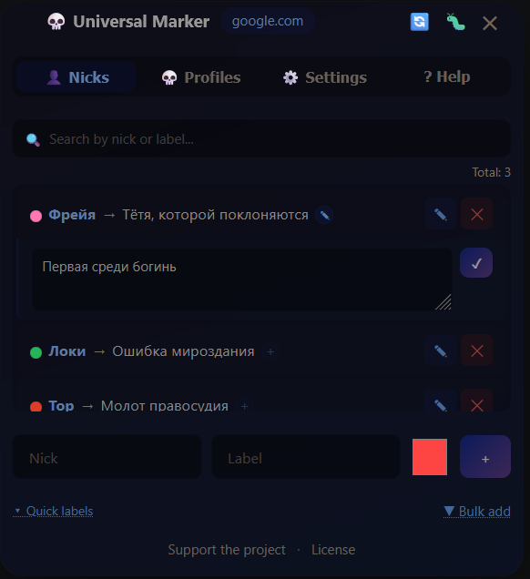
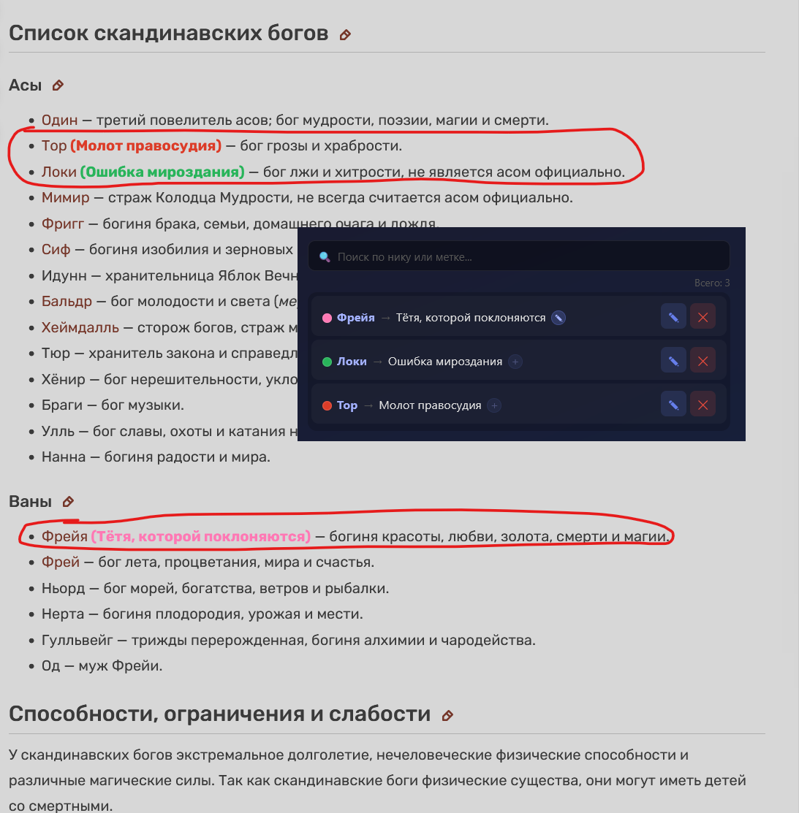
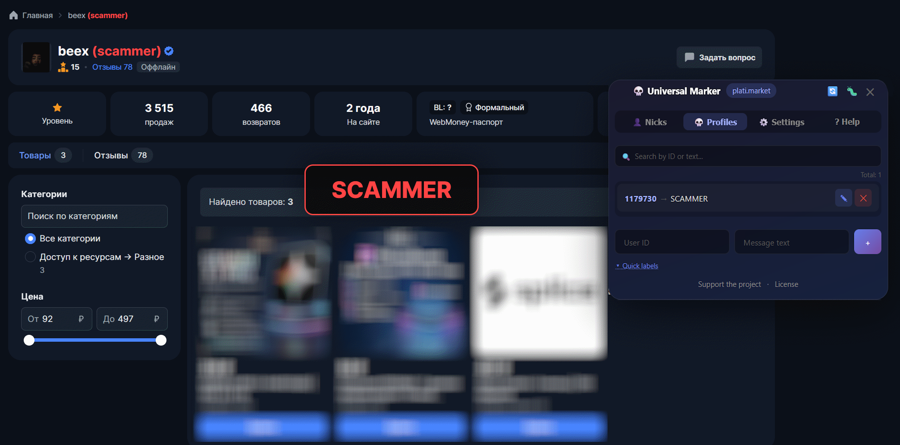
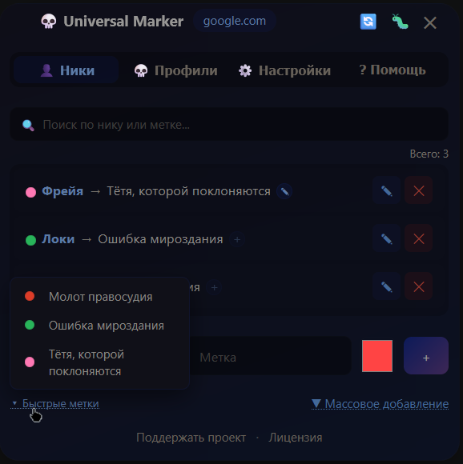
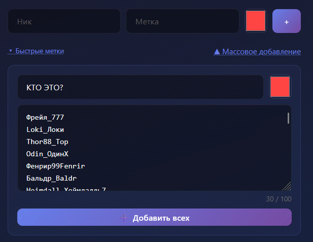
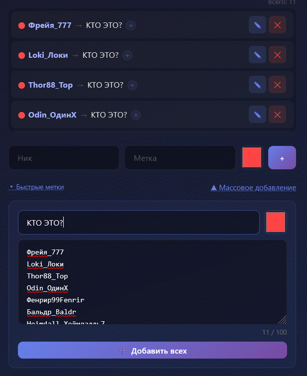
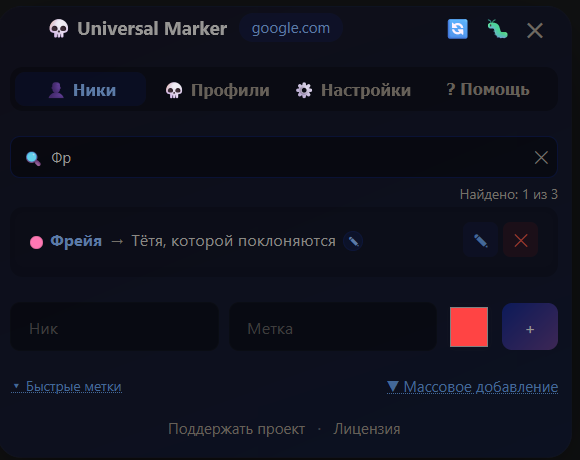
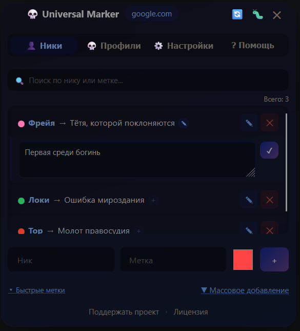
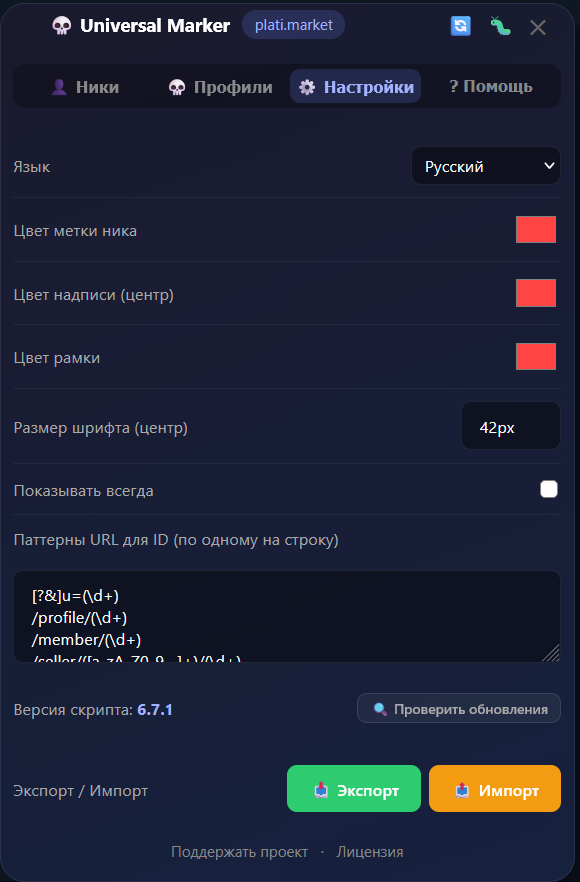

# 💀 Universal Marker

[English](README.md) | [Русский](README.ru.md)

Tampermonkey userscript — highlights nicknames and shows messages on profiles on any site. Essential for forums, marketplaces and any community where you need to remember who is who.

> Version: 6.7.0 | Works on any site (`*://*/*`)

---

## 📋 Contents

- [Installation](#installation)
- [Features](#features)
  - [Nickname highlighting](#nickname-highlighting)
  - [Profile messages](#profile-messages)
  - [Quick labels](#quick-labels)
  - [Bulk add](#bulk-add)
  - [Search](#search)
  - [Notes](#notes)
  - [Settings](#settings)
  - [Export and import](#export-and-import)
  - [Updates](#updates)
- [Data storage](#data-storage)

---

## Installation

**Step 1.** Install the Tampermonkey extension for your browser:

- [Chrome / Edge / Opera](https://www.tampermonkey.net/)
- [Firefox](https://www.tampermonkey.net/?browser=firefox)

**Step 2.** Click the button below to install the script:

[](https://raw.githubusercontent.com/Vidrimers/Universal-marker/refs/heads/master/universal.user.js)

> When you open the link, Tampermonkey recognizes the script and opens the install dialog. Click **"Install"**.


---

## Features

After installation a small 💀 button appears in the bottom left corner of any page. Click it to open the control panel.


<!--  -->

---

### Nickname highlighting

The **👤 Nicks** tab — add a user's nickname and a label. The script finds every mention of that nickname on the page and appends your label next to it in color.

**Example:**

```
beex → scammer
```

Result on the page: `beex` **(scammer)**

Each nickname can have an **individual label color** — e.g. red for toxic users, green for verified people. The default color comes from settings.




---

### Profile messages

The **💀 Profiles** tab — when you open a specific user's profile page, a big message appears in the center of the screen.

You need to specify the **user ID** (numeric) and the message text. The script automatically detects the ID from the URL using the configured patterns.

**Example:** opening `/seller/beex/1179730` shows the message **SCAMMER**.



---

### Quick labels

The **▾ Quick labels** button under the add row — shows a list of all unique labels you have already used. Click a label to instantly fill the field along with the color — no need to type the same thing over and over.



---

### Bulk add

The **▼ Bulk add** button — lets you add up to 100 nicknames at once. Paste a list of nicknames one per line, set a shared label and color.




---

### Search

Each tab has a search bar — it filters the list instantly as you type. Search works across nickname, label and note text at once. Shows a counter of found entries.



---

### Notes

Every nickname has a note button:

- **+** (semi-transparent) — no note yet, click to add
- **✎** (blue) — a note exists, click to view or edit

The note expands right under the nickname row — it takes no extra space when not needed.



---

### Settings

The **⚙️ Settings** tab:

| Parameter | Description |
| --------------------- | ------------------------------------------- |
| Language | Interface language (English / Русский) |
| Nick label color | Default color for new nicknames |
| Message color (center) | Text color of the big profile message |
| Border color | Border color of the big message |
| Font size (center) | Message text size, e.g. `42px` |
| Show always | The profile message never fades on its own |
| URL patterns for ID | Regex to extract the user ID from the URL |

**URL patterns** — if a site uses a non-standard profile link format, add your own pattern. By default these formats are supported: `/profile/123`, `/member/123`, `?u=123`.

Example for plati.market: `/seller/[^/]+/(\d+)`



---

### Export and import

Data is stored separately for each site. Buttons are in the **⚙️ Settings** tab:

| Button | Action |
| ---------------------- | -------------------------------------------- |
| 📥 Export | Download data for all sites as one JSON file |
| 📤 Import | Load data for all sites from a JSON file |
| 🔍 Check for updates | Check GitHub for a new script version |

The header buttons: 🔄 reloads the page (apply changes), 🐛 opens the bug report form.

---

### Updates

When the panel opens, the script quietly checks GitHub for a new version (at most once a day). If an update is available — a green banner appears:

```
🆕 Update available: v6.6 → v6.7   [⬆️ Install]
```

Click **"Install"** — Tampermonkey opens the update dialog.


---

## Data storage

Data is saved to Tampermonkey storage (`GM_storage`) — it **survives** cookie and browser cache clears. Each site keeps its data separately.

JSON structure on export:

```json
{
  "nicknames": {
    "username": {
      "label": "toxic",
      "color": "#ff4444",
      "note": "rude in every thread"
    }
  },
  "profileMessages": {
    "123456": "SCAMMER"
  },
  "settings": { ... }
}
```
